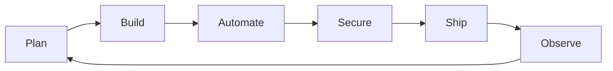

**I build the pipelines, platforms and tooling that let teams ship faster, safer and with less friction.**
 

 

 
## 👋 About me
 
I work at the intersection of **DevOps, cloud engineering and automation**, with a focus on turning manual, error-prone processes into repeatable, observable and secure workflows. I am currently exploring how **generative AI** (Amazon Bedrock, agent frameworks) can be applied to everyday engineering and delivery problems.
 
- 🔭 **Building:** browser-based developer tooling that needs no install and no server
- 🌱 **Exploring:** Amazon Bedrock, RAG, guardrails and agent workflows
- 🤝 **Open to:** collaboration on DevOps, automation and AI-assisted engineering
## ⚙️ How I work
 

 
## 🚀 Featured projects
 
| Project | What it is | Tech |
| :-- | :-- | :-- |
| 🧰 [**LocalKit**](https://github.com/veersudhir83/local-toolkit) · [live demo](https://veersudhir83.github.io/local-toolkit/) | A zero-install, zero-dependency developer toolkit that runs entirely in the browser. Includes an API client (Postman-style, with collections and import/export) and a task tracker. Every tool is a single self-contained HTML file. | `HTML` `JavaScript` `GitHub Actions` |
| 🌐 [**Portfolio**](https://github.com/veersudhir83/my-portfolio) | Personal portfolio site, hosted on GitHub Pages. | `HTML` `CSS` |
| 🤖 [**Amazon Bedrock for Beginners**](https://github.com/veersudhir83/sample-amazon-bedrock-for-beginners) | Fork of the AWS samples repo, used for hands-on learning: Converse API, tool use, RAG with Knowledge Bases, guardrails and agents built with the Strands Agents SDK. | `Python` `AWS` `Bedrock` |
 
## 🛠️ Toolbox
 

## 🤝 Let's connect
 
I am always happy to talk about DevOps practices, cloud automation and applied AI.
The quickest way to reach me is [LinkedIn](https://www.linkedin.com/in/sudheer-kumar-veeravalli-69944514/).
 

 
